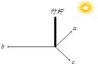

# Mathematics (Grade 3)

**ID**: 06776aa7
**难度**: medium
**题型**: multiple_choice

## 题目
（  ）是这根竹竿的影子．
$\begin{description}
\item A．a\item B．b\item C．c
\end{description}$

## 解答

**答案**: B

1. Step1:明确阳光下物体影子与太阳方向的关系，即影子与太阳方向相反
2. Step2:观察图中太阳位置，太阳在右上方
3. Step3:根据上述关系，判断竹竿影子方向，应在竹竿左面
4. Step4:查看选项，发现选项B的b在竹竿左面，所以答案是B

## 知识点

**知识点**:
  - 从不同方向观察物体和几何体．

---
