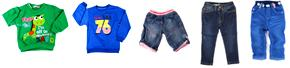

# Mathematics (Grade 3)

**ID**: 088c7a8a
**难度**: medium
**题型**: multiple_choice

## 题目
下面的服装可以有（     ）种不同的穿法。

A．5
B．6
C．8

## 解答

**答案**: B

1. Step1:观察可知有2件上衣和3条裤子
2. Step2:根据搭配的乘法原理，每件上衣都可以与3条裤子分别搭配
3. Step3:所以搭配方法一共有2×3 = 6种

## 知识点

**知识点**:
  - 小学数学;数与代数;应用题;常见的数学问题;搭配问题

---
