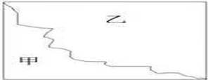

# Mathematics (Grade 3)

**ID**: 08e6f2a5
**难度**: medium
**题型**: multiple_choice

## 题目

甲、乙两图的周长（  ）
A．甲长
B．乙长
C．甲乙一样长

## 解答

**答案**: C

1. Step1:观察图形可知，甲的周长是由长方形的一条长、一条宽以及中间的折线组成
2. Step2:乙的周长同样是由长方形的一条长、一条宽以及中间的折线组成
3. Step3:因为甲乙共用中间的折线，且长方形的长和宽是固定的，所以甲乙的周长组成部分长度都相等
4. Step4:由此可得甲乙的周长一样长，答案选C

## 知识点

**知识点**:
  - 

---
