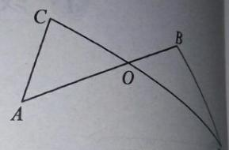

# Mathematics (Grade 3)

**ID**: 0f2bef72
**难度**: medium
**题型**: multiple_choice

## 题目
如图，如果以点A，B，C，D，O为端点，其中共有(    )条线段。
 (A)4
 (B)6
 (C)8
 (D)10

## 解答

**答案**: C

1. Step1:明确线段的定义为两端点之间有一条线段
2. Step2:依次找出以点A为端点的线段：AC，AO，AB
3. Step3:找出以点C为端点且未重复的线段：CO
4. Step4:找出以点O为端点且未重复的线段：OB，OD
5. Step5:找出以点B为端点且未重复的线段：BD
6. Step6:统计上述找出的线段数量，共8条
7. Step7:根据选项，选择正确答案C

## 知识点

**知识点**:
  - 

---
