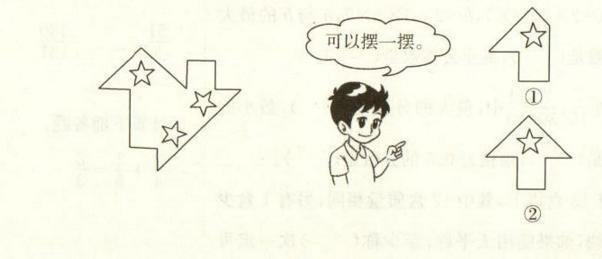

# Mathematics (Grade 3)

**ID**: 105583fc
**难度**: medium
**题型**: multiple_choice

## 题目
下面是由一个图形平移和旋转画出来的，你能圈出是右边哪个图形吗？（可以摆一摆）

## 解答

**答案**: ②

1. Step1:观察右侧图形①，发现无论怎样平移和旋转都无法拼出左侧图形。
2. Step2:观察右侧图形②，通过旋转和拼接可以得到左侧图形。
3. Step3:综上，答案是图形②。

## 知识点

**知识点**:
  - 

---
