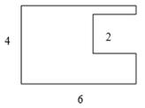

# Mathematics (Grade 3)

**ID**: 14612fec
**难度**: medium
**题型**: multiple_choice

## 题目
如图所示，在一个长为 6 厘米，宽为 4 厘米的长方形纸片上剪去一个边长为 2 厘米的正方形．如果剪去的正方形在右边，那么剩下的图形周长是___________厘米．

A．18
B．22
C．20
D．24

## 解答

**答案**: D

1. Step1:计算原长方形的周长，根据长方形周长公式 C=(a + b)×2（其中 a 为长，b 为宽），这里 a = 6 厘米，b = 4 厘米，所以原长方形周长为(6 + 4)×2 = 20 厘米。
2. Step2:分析剪去右边边长为 2 厘米的正方形后图形周长的变化情况，发现剪去正方形后，原长方形的周长并没有减少，反而增加了正方形两条边长，增加的长度为 2×2 = 4 厘米。
3. Step3:计算剩下图形的周长，用原长方形周长加上增加的长度，即 20 + 4 = 24 厘米。

## 知识点

**知识点**:
  - 小学数学;图形与几何;平面图形;组合图形的周长

---
