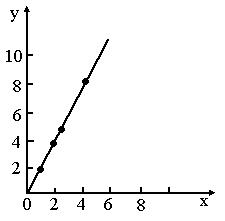

# Mathematics (Grade 3)

**ID**: 15223d13
**难度**: medium
**题型**: multiple_choice

## 题目
如图，点(0，0)、(1，2)、(2，4)、(3，6)均在一条直线上，下面各点中，点（  ）不在这条直线上．

$\begin{description}
\item A．(5，10)\item B．(4，8)\item C．(10，5)\item D．(2.5，5)
\end{description}$

## 解答

**答案**: C

1. Step1:设这条直线的表达式为y = kx + b，把点(0，0)代入，可得0 = k×0 + b，解得b = 0。
2. Step2:再把点(1，2)代入y = kx，可得2 = k×1，解得k = 2，所以直线表达式为y = 2x。
3. Step3:对于选项A，当x = 5时，y = 2×5 = 10，所以点(5，10)在直线上。
4. Step4:对于选项B，当x = 4时，y = 2×4 = 8，所以点(4，8)在直线上。
5. Step5:对于选项C，当x = 10时，y = 2×10 = 20≠5，所以点(10，5)不在直线上。
6. Step6:对于选项D，当x = 2.5时，y = 2×2.5 = 5，所以点(2.5，5)在直线上。
7. Step7:综上，答案选C。

## 知识点

**知识点**:
  - 

---
