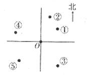

# Mathematics (Grade 3)

**ID**: 16772d21
**难度**: medium
**题型**: multiple_choice

## 题目
如图，以O点为观测点，在O点西南的点是（    ）。

$\begin{description}
\item A．①②\item B．③④\item C．⑤
\end{description}$

## 解答

**答案**: A

1. Step1:明确方向规则，上北下南，左西右东，西南方向是西和南之间的方向，即左下角方向。
2. Step2:观察图中各点位置，①②在O点东北方向，③在O点东南方向，④在O点西北方向，⑤在O点西南方向。
3. Step3:根据题目要求，以O点为观测点找在O点西南的点，确定是⑤，答案选C。

## 知识点

**知识点**:
  - 

---
