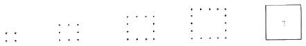

# Mathematics (Grade 3)

**ID**: 1c7eaa41
**难度**: medium
**题型**: multiple_choice

## 题目
观察下列点阵图并找出规律，下一个点阵图中点的个数为（ ）。 

$\begin{description}
\item A．16点\item B．18点\item C．20点
\end{description}$

## 解答

**答案**: C

1. Step1:观察第一个点阵图，有4个点，可看作2×2 = 4；
2. Step2:观察第二个点阵图，有8个点，可看作2×4 = 8；
3. Step3:观察第三个点阵图，有12个点，可看作2×6 = 12；
4. Step4:观察第四个点阵图，有16个点，可看作2×8 = 16；
5. Step5:总结规律为第n个点阵图中点的个数是2×(2n)；
6. Step6:那么下一个即第五个点阵图中点的个数为2×(2×5)=20个，所以答案选C。

## 知识点

**知识点**:
  - 小学数学;数与代数;应用题;常见的数学问题;数与形

---
