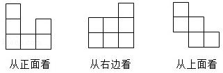

# Mathematics (Grade 3)

**ID**: 1d82b181
**难度**: medium
**题型**: multiple_choice

## 题目
一个物体从三个方向看如图，那么它由（  ）个小正方体拼成的。

$\begin{description}
\item A．18\item B．10\item C．9\item D．8
\end{description}$

## 解答

**答案**: C

1. Step1:从上面看可知最底层有6个小正方体
2. Step2:从正面看，左边最高3层，中间最高1层，右边最高2层
3. Step3:结合从右边看的图形，可知立体图形左边3层，中间1层，右边2层，且在底层6个小正方体基础上，上面还有3个小正方体
4. Step4:计算小正方体总数为6 + 3 = 9个

## 知识点

**知识点**:
  - 

---
