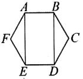

# Mathematics (Grade 3)

**ID**: 1f06b269
**难度**: medium
**题型**: multiple_choice

## 题目
下图中有（   ）组线段互相平行。

$\begin{description}
\item A．3\item B．4\item C．5
\end{description}$

## 解答

**答案**: B

1. Step1:观察图形，先看水平方向，线段AB与线段ED互相平行
2. Step2:再看倾斜方向，线段AF与线段CD互相平行
3. Step3:还有倾斜方向，线段FE与线段BC互相平行
4. Step4:另外，AB和FE也互相平行，ED和BC也互相平行
5. Step5:数出互相平行的线段组数共4组，所以答案选B

## 知识点

**知识点**:
  - 小学数学;图形与几何;平面图形;平行与垂直的特征、性质

---
