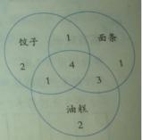

# Mathematics (Grade 3)

**ID**: 23966cac
**难度**: medium
**题型**: multiple_choice

## 题目
两家游玩结束，在饭店吃饭，主食有饺子、油糕、面条，右图是大家选择主食的情况，吃饺子的有（    ）．
 A.2人
 B.4人
 C.8人

 饺子
  面条
  油糕
  1 2 4 1 1 3 2

## 解答

**答案**: C

1. Step1:明确题目所求为吃饺子的人数
2. Step2:观察图形，发现吃饺子的人数由三个部分组成，分别是只吃饺子的2人、吃饺子和面条的1人、吃饺子和油糕的4人、三种都吃的1人
3. Step3:将上述三个部分的人数相加，即2 + 1 + 4 + 1
4. Step4:计算2 + 1 + 4 + 1的结果为8人
5. Step5:根据选项，找到对应的答案为C

## 知识点

**知识点**:
  - --

---
