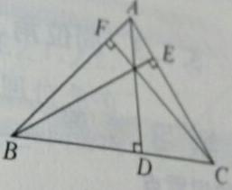

# Mathematics (Grade 3)

**ID**: 2440080f
**难度**: medium
**题型**: multiple_choice

## 题目
如图，图中有三组互相垂直的线段，其中AD的长是(    )

 A．点B到AC的距离
 B．点C到AB的距离
 C．点A到BC的距离
 D．以上都不对

## 解答

**答案**: C

1. Step1:根据点到直线的距离的定义，即直线外一点到垂足之间的距离叫做点到直线的距离。
2. Step2:观察图形可知AD⊥BC，点A为直线BC外一点，D为垂足。
3. Step3:所以AD的长是点A到BC的距离，故答案选C。

## 知识点

**知识点**:
  - 

---
