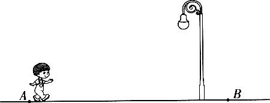

# Mathematics (Grade 3)

**ID**: 2fde639d
**难度**: medium
**题型**: multiple_choice

## 题目
如图，晚上小亮在路灯下散步，在小亮由A点走向B点的过程中，他在地上的影子(    )。

A．逐渐变短
B．逐渐变长
C．先变短后变长
D．先变长后变短

## 解答

**答案**: C

1. Step1:明确小亮在路灯下由A点走向B点的运动过程，存在靠近路灯和远离路灯两个阶段。
2. Step2:根据生活常识和光沿直线传播原理，当小亮靠近路灯时，影子逐渐变短。
3. Step3:当小亮远离路灯时，影子逐渐变长。
4. Step4:综合上述两个阶段，可知小亮在由A点走向B点的过程中，影子先变短后变长，所以答案选C。

## 知识点

**知识点**:
  - 

---
