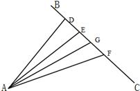

# Mathematics (Grade 3)

**ID**: 31bdad56
**难度**: medium
**题型**: multiple_choice

## 题目
图中，$\text{A}$点到直线$\text{BC}$的线段中，最短的是（  ）

A．AD
B．AE
C．AF
D．AG

## 解答

**答案**: A

1. Step1:明确题目要求是找出A点到直线BC的线段中最短的线段
2. Step2:依据‘点到直线的距离，垂线段最短’这一原理来判断
3. Step3:观察图形，发现AD是A点到直线BC的垂线段
4. Step4:得出结论，最短的线段是AD，即答案为A

## 知识点

**知识点**:
  - 

---
