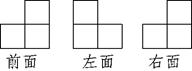

# Mathematics (Grade 3)

**ID**: 391aa21b
**难度**: medium
**题型**: multiple_choice

## 题目
一个由大小一样的小正方体组成的立体图形，从不同的方向观察分别是
，这个立体图形至少是由(  )个小正方体组成的。
A．3
B．4
C．5

## 解答

**答案**: A

1. Step1:从前面看，至少有3个小正方体，呈两层，底层2个，上层1个在左边；
2. Step2:从左面看，图形符合前面看到的两层结构，没有额外增加小正方体数量的信息；
3. Step3:从右面看，同样符合前面看到的两层结构，也没有额外增加小正方体数量的信息；
4. Step4:综合三个方向观察的情况，这个立体图形至少由3个小正方体组成，所以答案选A。

## 知识点

**知识点**:
  - 

---
