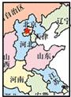

# Mathematics (Grade 3)

**ID**: 3c47de4d
**难度**: medium
**题型**: multiple_choice

## 题目
图中，山东省在北京市的(  )

A．西偏南方向
B．东偏南方向
C．西偏北方向

## 解答

**答案**: B

1. Step1:明确题目是判断山东省在北京市的方向
2. Step2:依据方位定义和图示确定方向关系
3. Step3:根据上北下南，左西右东的规则进行判断
4. Step4:得出山东省在北京市的东偏南方向，对应选项B

## 知识点

**知识点**:
  - 方向．

---
