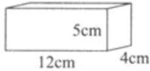

# Mathematics (Grade 3)

**ID**: 411576dc
**难度**: medium
**题型**: multiple_choice

## 题目
右图长方体底面的面积是(  )

A．60平方厘米
B．48平方厘米
C．20平方厘米

## 解答

**答案**: B

1. Step1:明确长方体底面是一个长方形，其长为12cm，宽为4cm
2. Step2:根据长方形面积公式，面积等于长乘宽，即计算12×4
3. Step3:得出12×4 = 48平方厘米，所以长方体底面面积是48平方厘米

## 知识点

**知识点**:
  - 长方形、正方形的面积．

---
