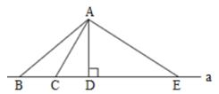

# Mathematics (Grade 3)

**ID**: 43366d70
**难度**: medium
**题型**: multiple_choice

## 题目
小乐从点A到直线a画了4条线段，分别长8厘米、6厘米、5厘米、10厘米，线段AD长（）。 

A.8厘米
B.6厘米
C.5厘米
D.10厘米

## 解答

**答案**: C

1. Step1:明确从直线外一点向已知直线画垂直线段和斜线时，垂线段最短这一性质
2. Step2:判断在8厘米、6厘米、5厘米、10厘米这4条线段中，哪条是最短的
3. Step3:得出5厘米是最短的，因为AD是垂线段，垂线段最短，所以AD长5厘米，答案选C

## 知识点

**知识点**:
  - 

---
