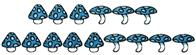

# Mathematics (Grade 3)

**ID**: 44713b07
**难度**: medium
**题型**: multiple_choice

## 题目
求一共有多少个蘑菇，下面算式表示不对的是(    )。

$\begin{description}
\item A．6+9\item B．8+6\item C．7+8
\end{description}$

## 解答

**答案**: B

1. Step1:观察蘑菇图，将蘑菇分成两部分，数出上面一排有7个蘑菇
2. Step2:数出下面一排有8个蘑菇
3. Step3:计算蘑菇总数为7 + 8 个
4. Step4:也可将蘑菇分为左边8个和右边6个，总数为8 + 6 个
5. Step5:逐一分析选项，A选项6 + 9与上述两种分法得到的算式都不同，B选项8 + 6正确，C选项7 + 8正确，所以表示不对的是A选项

## 知识点

**知识点**:
  - 小学数学;数与代数;应用题;简单应用题;整数简单应用题

---
