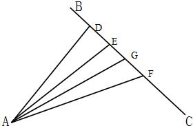

# Mathematics (Grade 3)

**ID**: 4e2c9699
**难度**: medium
**题型**: multiple_choice

## 题目
图中，A点到直线BC的线段中，最短的是(  )

A．AD
B．AE
C．AF
D．AG

## 解答

**答案**: A

1. Step1:明确问题是找出图中A点到直线BC的线段中最短的线段
2. Step2:依据‘点到直线的距离，垂线段最短’这一原理
3. Step3:观察图形，确定AD是A点到直线BC的垂线段
4. Step4:得出结论，A点到直线BC的线段中最短的是AD，所以答案选A

## 知识点

**知识点**:
  - 垂直与平行的特征及性质．

---
