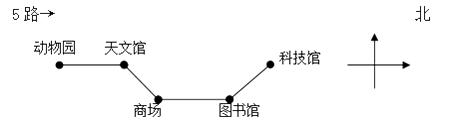

# Mathematics (Grade 3)

**ID**: 507d2603
**难度**: medium
**题型**: multiple_choice

## 题目
图书馆在科技馆的（  ）方向。

A．西北
B．东北
C．西南
D．东南

## 解答

**答案**: C

1. Step1:根据图中右上角的方向标识可知，此图遵循上北下南，左西右东的方向规则。
2. Step2:观察图中图书馆和科技馆的位置关系，图书馆在科技馆的左下方。
3. Step3:按照方向规则，左为西，下为南，所以图书馆在科技馆的西南方向，答案选C。

## 知识点

**知识点**:
  - 

---
