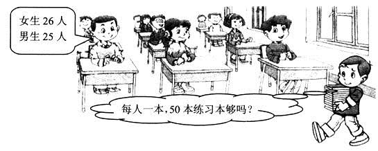

# Mathematics (Grade 3)

**ID**: 5335ed2e
**难度**: medium
**题型**: multiple_choice

## 题目

（1）先算出一共有多少人： 
________ ________ ________= ________（人）
（2）每人一本够吗？  （____）
A．够
B．不够

## 解答

**答案**: B

1. Step1:已知女生26人，男生25人，要计算总人数，根据加法的意义，用女生人数加上男生人数，即26 + 25 = 51人
2. Step2:因为有51人，而练习本只有50本，51 > 50，所以每人一本不够，答案选B

## 知识点

**知识点**:
  - 小学数学;数与代数;应用题;简单应用题;整数简单应用题

---
