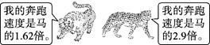

# Mathematics (Grade 3)

**ID**: 599ff47d
**难度**: medium
**题型**: multiple_choice

## 题目
马的奔跑速度是每小时40.5 km。猎豹每小时奔跑多少千米？列式正确的是(  )。

$\begin{description}
\item A．40.5×1.62\item B．40.5×2.9\item C．40.5＋2.9
\end{description}$

## 解答

**答案**: B

1. Step1:已知马的奔跑速度是每小时40.5km，且猎豹的奔跑速度是马的2.9倍
2. Step2:根据求一个数的几倍是多少用乘法计算，可知求猎豹的速度应列式为40.5×2.9
3. Step3:观察选项，A选项40.5×1.62不符合，C选项40.5＋2.9也不符合，B选项40.5×2.9符合要求，所以答案是B

## 知识点

**知识点**:
  - 小学数学;数与代数;应用题;常见的数学问题;行程问题

---
