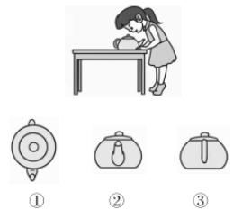

# Mathematics (Grade 3)

**ID**: 5f1b70c8
**难度**: medium
**题型**: multiple_choice

## 题目
小女孩子看到的是（）号图。

## 解答

**答案**: ①

1. Step1:明确要确定小女孩看到的图形，需先明确观察位置
2. Step2:根据给定图形，判断出小女孩站在茶壶的上面
3. Step3:因为小女孩站在茶壶上面，所以得出小女孩可以看到茶壶的壶盖
4. Step4:根据上述推理，得出小女孩看到的是①号图

## 知识点

**知识点**:
  - 从不同方向观察一个简单物体

---
