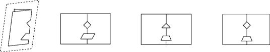

# Mathematics (Grade 3)

**ID**: 663f80db
**难度**: medium
**题型**: multiple_choice

## 题目
欣欣在对折好的纸上剪了两个洞，打开后会是哪一个？想一想，做一做。在正确答案下面画“√”。

（_____）（_____）（_____）

## 解答

**答案**: C

1. Step1:明确题目是判断对折纸剪两个洞打开后的样子
2. Step2:分析选项A，其洞的位置和数量与对折剪纸打开后的预期不符
3. Step3:分析选项B，其洞的位置和数量也不符合对折剪纸打开后的预期
4. Step4:分析选项C，其洞的位置和数量符合对折剪纸打开后的样子，所以答案是C

## 知识点

**知识点**:
  - 小学数学;图形与几何;图形与变换

---
