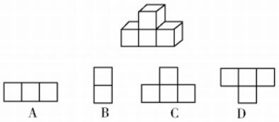

# Mathematics (Grade 3)

**ID**: 664072ab
**难度**: medium
**题型**: multiple_choice

## 题目
观察下面的立体图形，从正面可以看到（）。

## 解答

**答案**: C

1. Step1:明确这是图形的三视图问题，需观察给定的立体图形。
2. Step2:确定该立体图形由两层组成。
3. Step3:判断从正面看能看到4个小正方形。
4. Step4:明确4个小正方形的位置关系为下面一排有3个，上面一排有1个且在最中间。
5. Step5:根据上述观察和判断，得出从正面看到的图形对应的选项为C。

## 知识点

**知识点**:
  - 从不同方向观察一个简单物体

---
