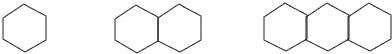

# Mathematics (Grade 3)

**ID**: 6d9622bb
**难度**: medium
**题型**: multiple_choice

## 题目
用小棒按下面方法摆正六边形，摆10个正六边形需要（     ）根小棒。

A．60
B．50
C．52
D．51

## 解答

**答案**: D

1. Step1:分析摆1个正六边形，需要6根小棒，可写成5×1 + 1
2. Step2:分析摆2个正六边形，需要11根小棒，可写成5×2 + 1
3. Step3:分析摆3个正六边形，需要16根小棒，可写成5×3 + 1
4. Step4:总结规律，摆n个正六边形需要的小棒数为5n + 1
5. Step5:当n = 10时，计算5×10 + 1 = 51根
6. Step6:得出摆10个正六边形需要51根小棒，答案选D

## 知识点

**知识点**:
  - 小学数学;数与代数;应用题;常见的数学问题;数与形

---
