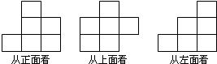

# Mathematics (Grade 3)

**ID**: 7e0ef3cc
**难度**: medium
**题型**: multiple_choice

## 题目
由几个相同的小正方体搭成的几何体的视图如图所示，则搭成这个几何体的小正方体的个数至少是(    )个．

## 解答

**答案**: 9

1. Step1:根据俯视图可知，该几何体的底层有6个小正方体
2. Step2:结合主视图和左视图，第二层至少有2个小正方体
3. Step3:从主视图可知，第三层有1个小正方体
4. Step4:计算搭成这个几何体的小正方体的最少个数，为6 + 2 + 1 = 9个

## 知识点

**知识点**:
  - 组合图形的计数；从不同方向观察物体和几何体．

---
