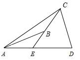

# Mathematics (Grade 3)

**ID**: 7e2a5954
**难度**: medium
**题型**: multiple_choice

## 题目
如图，图中小于平角的角是个数是(  )
A．9
B．4
C．11
D．6

## 解答

**答案**: C

1. Step1:明确任务是找出图中小于平角的角的个数
2. Step2:依次观察图中的角，发现∠CAB小于平角
3. Step3:发现∠CAE小于平角
4. Step4:发现∠BAE小于平角
5. Step5:发现∠AEB小于平角
6. Step6:发现∠CED小于平角
7. Step7:发现∠D小于平角
8. Step8:发现∠DCE小于平角
9. Step9:发现∠DCA小于平角
10. Step10:发现∠ECA小于平角
11. Step11:发现∠EBA小于平角
12. Step12:发现∠ABC小于平角
13. Step13:统计小于平角的角的个数为11个
14. Step14:根据选项，选择C

## 知识点

**知识点**:
  - 组合图形的计数．

---
