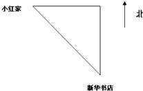

# Mathematics (Grade 3)

**ID**: 7eae65f1
**难度**: medium
**题型**: multiple_choice

## 题目
如图，新华书店在小红家的(  )

A．西南方向
B．东南方向
C．东北方向

## 解答

**答案**: B

1. Step1:明确以小红家为观测点
2. Step2:依据上北下南，左西右东的基本方位辨别法
3. Step3:结合图中的信息进行判断
4. Step4:得出新华书店在小红家的东南方向
5. Step5:确定答案为选项B

## 知识点

**知识点**:
  - 方向．

---
