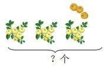

# Mathematics (Grade 3)

**ID**: 880a9301
**难度**: medium
**题型**: multiple_choice

## 题目
看图列算式错误的是（   ）。

A．5×3+3
B．3×6
C．5×4-2

## 解答

**答案**: B

1. Step1:分析选项A，图中每组有5个，有3组，另外还有3个，所以可列式5×3 + 3，该选项正确
2. Step2:分析选项B，图中并不符合3×6所表示的含义，该选项错误
3. Step3:分析选项C，把图看成每组4个，有5组，但是多算了2个，所以可列式5×4 - 2，该选项正确
4. Step4:综上，列算式错误的是B

## 知识点

**知识点**:
  - 小学数学;数与代数;应用题;常见的数学问题;图文问题

---
