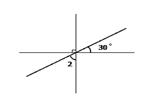

# Mathematics (Grade 3)

**ID**: 896e4ca2
**难度**: medium
**题型**: multiple_choice

## 题目
下图中，∠2＝（    ）

A．60°
B．120°
C．150°

## 解答

**答案**: A

1. Step1:观察图形可知，与∠2相邻的角是直角和一个30°的角
2. Step2:因为平角为180°，所以∠2 = 180° - 90° - 30°
3. Step3:计算180° - 90° - 30° = 60°，所以∠2 = 60°，答案选A

## 知识点

**知识点**:
  - 

---
