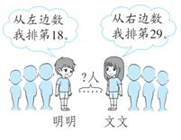

# Mathematics (Grade 3)

**ID**: 8a7c5a2e
**难度**: medium
**题型**: multiple_choice

## 题目
有51人站成一排，求明明和文文之间有多少人，下面列式正确的是(  )。

A．51+29+18
B．51-18-29
C．18+29

## 解答

**答案**: B

1. Step1:已知总人数是51人，从左边数明明排第18，这18人包括明明
2. Step2:从右边数文文排第29，这29人包括文文
3. Step3:要求明明和文文之间的人数，用总人数51减去包括明明的18人，再减去包括文文的29人，即51 - 18 - 29，所以列式正确的是B

## 知识点

**知识点**:
  - 小学数学;数与代数;应用题;常见的数学问题;图文问题

---
