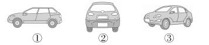

# Mathematics (Grade 3)

**ID**: 9109b136
**难度**: medium
**题型**: multiple_choice

## 题目
一辆汽车从笑笑面前开过，笑笑依次拍摄了以下三幅照片，按拍摄时间的先后顺序排列正确的是（）。

A.①②③
B.③①②
C.③②①
D.②①③

## 解答

**答案**: B

1. Step1:根据解析2可知，笑笑先拍到的是车子的前面，观察三幅图，③是车子前面
2. Step2:接着拍到的是车子的侧面，①是车子侧面
3. Step3:最后拍到的是车子的后面，②是车子后面
4. Step4:所以按拍摄时间先后顺序为③①②，答案选B

## 知识点

**知识点**:
  - 从三个不同方向观察物体

---
