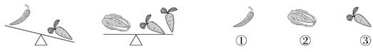

# Mathematics (Grade 3)

**ID**: 953fc213
**难度**: medium
**题型**: multiple_choice

## 题目
哪个最重？（   ）。

$\begin{description}
\item A．①\item B．②\item C．③
\end{description}$

## 解答

**答案**: B

1. Step1:观察第一个天平，可知①的重量小于③的重量
2. Step2:观察第二个天平，可知②的重量等于两个③的重量
3. Step3:根据前面两个步骤，②的重量大于③的重量，③的重量大于①的重量，所以②最重

## 知识点

**知识点**:
  - 小学数学;统计和概率;统计

---
