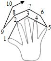

# Mathematics (Grade 3)

**ID**: 9a473db1
**难度**: medium
**题型**: multiple_choice

## 题目
请同学们伸出左手，如图所示从这只手大拇指开始的那样数数字1，2，3…，那么数字2011落在哪个手指上？（  ）
A．大拇指
B．食指
C．中指
D．无名指

## 解答

**答案**: C

1. Step1:明确从大拇指开始数数字的规律，即从大拇指到小指再到食指为一个循环，一个循环包含8个数字
2. Step2:用数字2011除以循环的数字个数8，即2011÷8
3. Step3:计算2011÷8的结果为251余3
4. Step4:根据计算结果，余数为3表示从大拇指开始数的第3个手指，即中指

## 知识点

**知识点**:
  - 数与形结合的规律．

---
