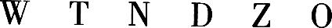

# Mathematics (Grade 3)

**ID**: 9f784cc6
**难度**: medium
**题型**: multiple_choice

## 题目
下面的英文字母中，是轴对称图形的有(    )个。

$\begin{description}
\item A．5\item B．4\item C．3
\end{description}$

## 解答

**答案**: C

1. Step1:明确轴对称图形的定义，即如果一个图形沿着一条直线对折后两部分完全重合，这样的图形叫做轴对称图形。
2. Step2:分析字母W，沿着水平方向的中线对折后两部分完全重合，所以W是轴对称图形。
3. Step3:分析字母T，沿着垂直方向的中线对折后两部分完全重合，所以T是轴对称图形。
4. Step4:分析字母N，无论沿哪条直线对折，两部分都不能完全重合，所以N不是轴对称图形。
5. Step5:分析字母D，沿着水平方向的中线对折后两部分完全重合，所以D是轴对称图形。
6. Step6:分析字母Z，无论沿哪条直线对折，两部分都不能完全重合，所以Z不是轴对称图形。
7. Step7:分析字母O，沿着水平方向和垂直方向的中线对折后两部分都能完全重合，所以O是轴对称图形。
8. Step8:统计轴对称图形的个数，W、T、D、O是轴对称图形，共4个。

## 知识点

**知识点**:
  - 

---
