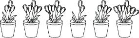

# Mathematics (Grade 3)

**ID**: a165282a
**难度**: medium
**题型**: multiple_choice

## 题目
从左数，有4朵花的是第（   ）盆。

$\begin{description}
\item A．4\item B．5\item C．2
\end{description}$

## 解答

**答案**: B

1. Step1:观察图片，从左往右依次数每盆花的数量
2. Step2:第一盆有3朵花，第二盆有4朵花，第三盆有5朵花，第四盆有2朵花，第五盆有3朵花，第六盆有4朵花
3. Step3:找出有4朵花的盆，发现第二盆和第六盆有4朵花
4. Step4:根据题目要求从左数，确定有4朵花的是第二盆，对应选项C

## 知识点

**知识点**:
  - 

---
