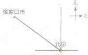

# Mathematics (Grade 3)

**ID**: abd4ddd6
**难度**: medium
**题型**: multiple_choice

## 题目
第24届冬季奥林匹克运动会将由北京市和张家口市联合主办．张家口市在北京市的(    )方向．

$\begin{description}
\item A．东南\item B．东北\item C．西南\item D．西北
\end{description}$

## 解答

**答案**: D

1. Step1:明确地图上的方向规则为上北下南，左西右东
2. Step2:观察图中张家口市相对于北京市的位置，发现其在北京市的左上方
3. Step3:根据方向规则，左上方对应的方向是西北方向，所以张家口市在北京市的西北方向，答案选D

## 知识点

**知识点**:
  - 小学数学;图形与几何;位置与方向;方向

---
