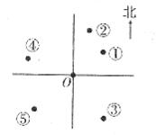

# Mathematics (Grade 3)

**ID**: ae863853
**难度**: medium
**题型**: multiple_choice

## 题目
如图，以O点为观测点，在O点西南的点是（    ）。

$\begin{description}
\item A．①②\item B．③④\item C．⑤
\end{description}$

## 解答

**答案**: A

1. Step1:明确方向的定义，在地图上，通常按照上北下南，左西右东的规则来确定方向。西南方向是指西和南之间的方向，也就是左下方的方向。
2. Step2:观察图中以O点为观测点，①②在O点的东北方向；③在O点的东南方向；④在O点的西北方向；⑤在O点的西南方向。
3. Step3:根据题目要求，找出在O点西南的点，确定是⑤，对应选项C。

## 知识点

**知识点**:
  - 

---
