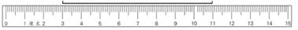

# Mathematics (Grade 3)

**ID**: b11a4f58
**难度**: medium
**题型**: multiple_choice

## 题目
下面的线段长(   )厘米．

A．9
B．8
C．7

## 解答

**答案**: B

1. Step1:观察刻度尺，确定线段一端对准刻度3，另一端对准刻度11
2. Step2:用末端刻度11减去起始端刻度3，即11 - 3
3. Step3:计算得出11 - 3 = 8，所以线段长8厘米，答案选B

## 知识点

**知识点**:
  - 小学数学;图形与几何;测量;常见的长度单位及换算;长度的测量方法

---
