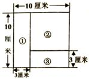

# Mathematics (Grade 3)

**ID**: b4b3b776
**难度**: medium
**题型**: multiple_choice

## 题目
下面算式（   ）求的是图形③的周长。

$\begin{description}
\item A．10×4\item B．（10+3）×2\item C．10×2\item D．（10-3）×4
\end{description}$

## 解答

**答案**: C

1. Step1:观察图形③，可知其为长方形，长为10 - 3 = 7厘米，宽为3厘米。
2. Step2:根据长方形周长公式C=(a + b)×2（a为长，b为宽），图形③周长为(7 + 3)×2 = 10×2厘米。
3. Step3:逐一分析选项，A选项10×4是边长为10厘米的正方形周长，不符合；B选项(10 + 3)×2不符合图形③周长计算；C选项10×2符合推导结果；D选项(10 - 3)×4不符合。
4. Step4:所以答案选C。

## 知识点

**知识点**:
  - 小学数学;图形与几何;平面图形;长方形和正方形;长方形的周长

---
