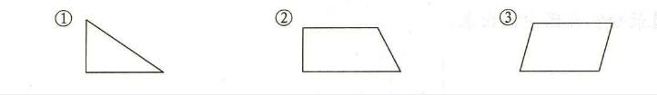

# Mathematics (Grade 3)

**ID**: be5d8f72
**难度**: medium
**题型**: multiple_choice

## 题目
下面三个图形中，既有互相垂直线段又有互相平行线段的是（    ）．

## 解答

**答案**: ②

1. Step1:明确任务是从三个图形中找出既有互相垂直线段又有互相平行线段的图形
2. Step2:根据平行和垂直的定义，观察图形①，发现它没有互相平行的线段
3. Step3:根据平行和垂直的定义，观察图形②，发现它既有平行线段又有垂直线段
4. Step4:根据平行和垂直的定义，观察图形③，发现它没有互相垂直的线段
5. Step5:得出结论，符合条件的图形是②

## 知识点

**知识点**:
  - 第八单元自主检测
--

---
