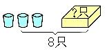

# Mathematics (Grade 3)

**ID**: c401d221
**难度**: medium
**题型**: multiple_choice

## 题目
看图列式计算，正确的是（ ） .

A．8＋3=11(只)
B．8－3=5(只)
C．8－5=3(只)
D．3＋8=11(只)

## 解答

**答案**: B

1. Step1:观察图片可知，总共有8只杯子，外面有3只
2. Step2:问题是求盒子里有几只杯子
3. Step3:求部分数量应该用总数减去已知部分数量，即8 - 3
4. Step4:计算8 - 3 = 5，所以答案是8－3=5(只)，选B

## 知识点

**知识点**:
  - 小学数学;数与代数;应用题;常见的数学问题;图文问题

---
