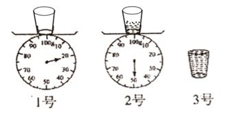

# Mathematics (Grade 3)

**ID**: c664ec5c
**难度**: medium
**题型**: multiple_choice

## 题目
如下图，3号杯中的水大约重（     ）克。

$\begin{description}
\item A．30克\item B．100克\item C．60克
\end{description}$

## 解答

**答案**: C

1. Step1:观察1号杯，可知空杯重20克。
2. Step2:观察2号杯，可知杯和水共重80克。
3. Step3:用2号杯杯和水的总重量80克减去1号杯空杯的重量20克，即80 - 20 = 60克，得到杯中水的重量，所以3号杯中的水大约重60克。

## 知识点

**知识点**:
  - 小学数学;数与代数;常见的量;质量单位及换算;质量及质量的常用单位;图形与几何;测量与作图;估测

---
