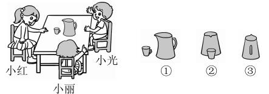

# Mathematics (Grade 3)

**ID**: c8ef16a4
**难度**: medium
**题型**: multiple_choice

## 题目
小光看到的是（）。

## 解答

**答案**: ③

1. Step1:明确本题考点为从不同方向观察物体，方法是根据三人位置结合不同方向观察物体的特点来判断。
2. Step2:根据从不同方向观察物体的方法可知，从前面看到的是一大一小两个杯子，从左边看到是大杯子前有一个小杯子，从右面看到的是一个大杯子。
3. Step3:观察小红、小光和小丽三人的位置，小光在物体的右侧。
4. Step4:因为从右面看到的是一个大杯子，所以小光看到的是③。

## 知识点

**知识点**:
  - 从不同方向观察一个简单物体

---
