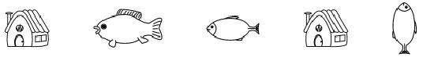

# Mathematics (Grade 3)

**ID**: ca61a580
**难度**: medium
**题型**: multiple_choice

## 题目
下面图形通过平移能重合的是（   ）和（   ）。

①          ②          ③        ④       ⑤
A．①④
B．②③
C．③⑤
D．①③

## 解答

**答案**: A

1. Step1:明确平移的概念，平移是指在平面内，将一个图形上的所有点都按照某个方向作相同距离的移动，平移不改变图形的形状和大小。
2. Step2:观察所给图形，①是房子图形，④也是房子图形，它们形状、大小完全相同，通过平移可以重合。
3. Step3:②是一种鱼的图形，③是另一种鱼的图形，它们形状不同，平移后不能重合。
4. Step4:③和⑤形状不同，平移后不能重合。
5. Step5:①和③形状不同，平移后不能重合。
6. Step6:综上，通过平移能重合的是①和④，答案是A。

## 知识点

**知识点**:
  - 小学数学;图形与几何;图形与变换;平移与平移现象

---
