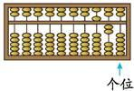

# Mathematics (Grade 3)

**ID**: ce1cc82b
**难度**: medium
**题型**: multiple_choice

## 题目
算盘
上表示的数是(  )．
$\begin{description}
\item A．52\item B．520\item C．120
\end{description}$

## 解答

**答案**: B

1. Step1:明确算盘的计数规则，梁上的一个珠子表示5，梁下的一个珠子表示1。
2. Step2:观察算盘，从右往左数，个位上梁下有2个珠子，表示2；十位上梁上有1个珠子，表示5个十即50。
3. Step3:组合起来这个数就是50 + 20 = 520，所以答案是B。

## 知识点

**知识点**:
  - 小学数学;数与代数;数的运算;算盘的认识与使用

---
