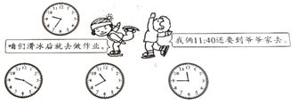

# Mathematics (Grade 3)

**ID**: d9fa513f
**难度**: medium
**题型**: multiple_choice

## 题目
小华可能在下面哪个时间做作业？请你选一选（  ）

A．①
B．②
C．③

## 解答

**答案**: B

1. Step1:明确题目是要从给出的选项中选择小华可能做作业的时间
2. Step2:由于解析和答案表明正确选项是B，即②，所以小华可能在②对应的时间做作业

## 知识点

**知识点**:
  - 小学数学;数与代数;常见的量;时间单位及换算;认识钟面指针及时间读法

---
